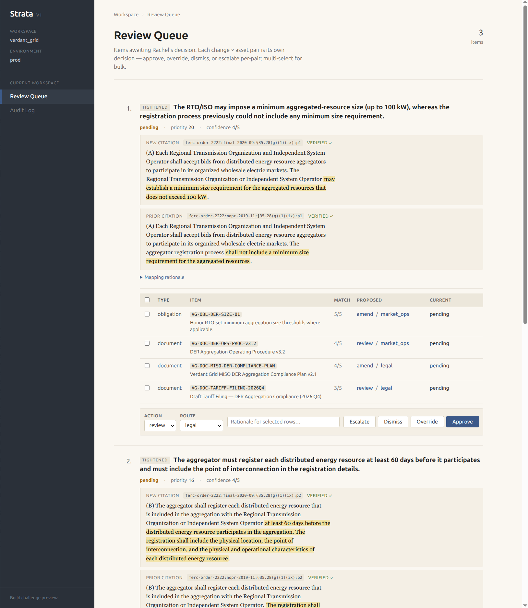
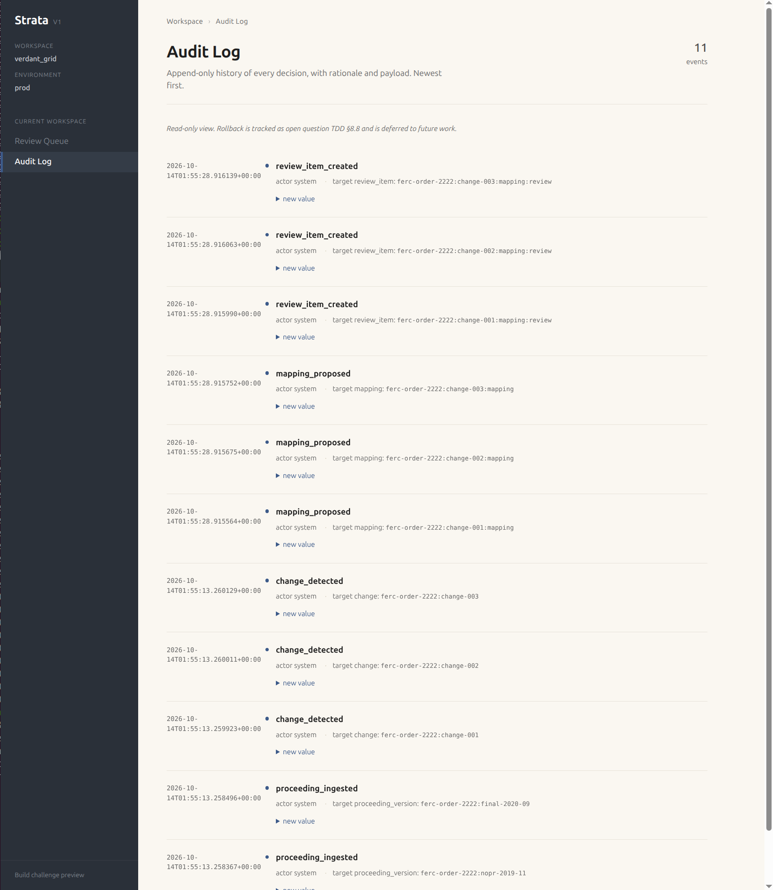

# Strata

A regulatory change-to-action workspace for in-house regulatory affairs
teams at regulated enterprises. Strata ingests versioned regulatory
proceedings alongside the company's own obligations, projects, and
documents; detects material changes between versions; cites the exact
source passage behind every claim; maps each change to the specific
internal state it affects; recommends an action; and routes it to the
right internal reviewer, with a full audit trail.

Submission to the AI Fund Engineer-in-Residence Build Challenge.

**First user.** Rachel Chen, Senior Manager of Regulatory Affairs at
Verdant Grid, a mid-size US investor-owned electric utility. v1 maps
changes between the draft (NOPR) and final text of FERC Order 2222 —
the 2020 rule on distributed-energy-resource aggregation — into
Verdant's internal obligations, projects, and documents.

## Governing documents

Read these first; the panel review follows roughly this order.

- [**CHALLENGE.md**](CHALLENGE.md) — the build-challenge brief this
  repo responds to.
- [**PRD.md**](PRD.md) — product requirements.
  [First user](PRD.md#1-the-user),
  [why alerts and search are insufficient](PRD.md#2-why-alerts-and-search-are-insufficient),
  [the wedge workflow](PRD.md#3-the-first-change-to-action-wedge-workflow),
  [trust and adoption metrics](PRD.md#4-trust-and-adoption-metrics-for-expert-users),
  [expansion beyond utilities](PRD.md#5-expansion-beyond-utilities),
  [non-goals](PRD.md#6-non-goals-for-v1),
  [open questions](PRD.md#7-open-questions-and-unvalidated-assumptions).
- [**TDD.md**](TDD.md) — technical design.
  [Architecture](TDD.md#1-system-overview),
  [data model](TDD.md#2-data-model),
  the 7-stage pipeline ([ingest](TDD.md#31-ingest) →
  [diff](TDD.md#32-version-diff) →
  [cite](TDD.md#33-citation-grounding-depth-area) →
  [extract](TDD.md#35-obligation-extraction) →
  [map](TDD.md#36-mapping) → route →
  [review/audit](TDD.md#37-review--audit)),
  [cross-cutting services](TDD.md#4-cross-cutting-infrastructure),
  [evals](TDD.md#5-evals-depth-area),
  [scaling pathway](TDD.md#7-scaling-pathway),
  [open technical questions](TDD.md#8-open-technical-questions).

Supporting references (consulted while writing code):

- [**CLAUDE.md**](CLAUDE.md) — code style, mandatory design-compliance
  rules, tooling, engineering principles.
- [**PROMPT_CONVENTIONS.md**](PROMPT_CONVENTIONS.md) — authoring
  conventions for LLM-task prompts (PromptSpec sections, response-model
  rules, integer-index selection).
- [**TEST_QUALITY.md**](TEST_QUALITY.md) — rules for writing tests that
  are actually useful.
- [**JEV.md**](JEV.md) — reference for Jev, TypeSafe AI's System One
  discrimination model (named across the TDD as the production path
  for structured discrimination tasks like citation verification,
  change-type classification, and routing).
- [**PREP_MATERIAL.md**](PREP_MATERIAL.md) — AI Fund's reviewer guide;
  informs how the submission is structured.

## Prerequisites

- **Python 3.12** or newer. Check with `python3.12 --version`.
- **git**, **make**.
- An **OpenAI API key**. v1 dispatches the four LLM tasks
  ([version_diff](src/version_diff.py),
  [citation_verify](src/citation/citation_verify.py),
  [obligation_extraction](src/obligation_extraction.py),
  [mapping](src/mapping.py)) to the OpenAI responses API with
  structured outputs. See
  [Non-goal in PRD §6](PRD.md#6-non-goals-for-v1): tenant-chosen
  providers / BYO keys / tenant-owned fine-tuned models land
  post-wedge through the existing
  [`ModelCaller` seam](TDD.md#41-llm-dispatch-modelcaller), but v1 is
  OpenAI only.

## Setup (from a fresh clone)

```
git clone git@github.com:ngs2410/strata-build-challenge.git strata
cd strata
python3.12 -m venv env3.12
env3.12/bin/pip install --upgrade pip
env3.12/bin/pip install -e '.[dev]'
cp .env.example .env
# Edit .env and set OPENAI_API_KEY=sk-...
source env3.12/bin/activate
```

The `env3.12` directory name is what the [`Makefile`](Makefile)
targets expect. If you prefer a different venv path, override the
Python interpreter when running the commands below
(`PYTHON=/path/to/python make eval` isn't wired up — easier to just
name your venv `env3.12`). The [`.env.example`](.env.example) file
documents every env variable the pipeline reads.

## Run the tests

```
pytest tests/
```

The suite is network-free (an autouse fixture in
[`tests/conftest.py`](tests/conftest.py) rewrites every LLM task to a
local [`stub://` backend](src/backends/stub_backend.py)) and runs in
about 2 seconds. Expect 185 tests to pass. Test authoring rules
live in [TEST_QUALITY.md](TEST_QUALITY.md).

Also useful:

- `make test-cov` — run with coverage; writes a terminal report.
- `make lint` — `ruff check src scripts tests`.
- `make format` — `ruff format` + `ruff check --fix`.

## Run the pipeline end-to-end

```
python -m scripts.main_detect_changes --tenant_id=verdant_grid --environment=prod
```

This drives [`scripts/main_detect_changes.py`](scripts/main_detect_changes.py)
through [`src/pipeline.py`](src/pipeline.py) — the full 7-stage
pipeline ([TDD §3](TDD.md#3-the-core-pipeline)) against the FERC
Order 2222 NOPR → Final Rule excerpts shipped in
[`data/tenants/verdant_grid/`](data/tenants/verdant_grid) and
Verdant Grid's seeded
[company context](data/tenants/verdant_grid/company_context.json)
(8 obligations / 3 projects / 5 documents). Outputs land under
`data/tenants/verdant_grid/prod/`:

- `proceedings.json` — ingested
  [`ProceedingVersion`](TDD.md#21-proceedingversion)s.
- `obligations.json` / `projects.json` / `documents.json` — company
  context ([TDD §2.4](TDD.md#24-obligation--project--document--the-company-context)).
- `changes.json` — detected material
  [`Change`](TDD.md#23-change-and-citation)s with grounded + verified
  citations.
- `extracted_obligations.json` — obligations extracted per version
  ([TDD §3.5](TDD.md#35-obligation-extraction)).
- `mappings.json` — change → affected items
  [`Mapping`](TDD.md#25-mapping)s.
- `review_items.json` — Rachel's prioritized queue
  ([TDD §2.6](TDD.md#26-reviewitem)).
- `audit_log.jsonl` — append-only audit of every state transition
  ([TDD §2.7](TDD.md#27-auditevent)).

Expect ~7 LLM calls per cold-cache run (1 version_diff + 1
citation_verify + 2 obligation_extraction + 3 mapping); ~15s
wall-clock. The [`ModelCaller`](TDD.md#41-llm-dispatch-modelcaller)
uses `diskcache` under `.model_cache/` so subsequent runs are <1s.

Script flags (all optional):

- `--tenant_id=<id>` (default `verdant_grid`): tenant to run.
- `--environment=<env>` (default `prod`): environment within tenant.
- `--dry_run`: compute everything but don't persist.
- `--k=<N>`: smoke-test on first N items (no-op at v1 cardinality).
- `--profile`: dump a cProfile top-50 to stderr.
- `--confirm_llm`: pause before every LLM call, show the rendered
  prompt and token-count estimate, and prompt for y/n. Useful for
  prompt debugging.

## Open the review UI

```
python -m scripts.main_review
```

[`scripts/main_review.py`](scripts/main_review.py) is a thin uvicorn
wrapper around the FastAPI app in [`src/web_app.py`](src/web_app.py)
(see [TDD §6.2](TDD.md#62-web-view)). Open
`http://127.0.0.1:8000/` in a browser — you'll be redirected to the
Verdant Grid queue. The UI has two pages:

- `/queue?tenant_id=verdant_grid&environment=prod` — Rachel's
  prioritized review queue (template:
  [`templates/queue.html`](templates/queue.html)). Each card shows
  the detected change, the cited passage text with the citing span
  `<mark>`-highlighted inline, the verification status, and a
  per-pair table of affected (change × asset) rows with per-item
  proposed action + proposed route. Rachel multi-selects rows and
  decides each pair via the bulk toolbar — **approve**, **override**,
  **dismiss**, or **escalate**. Each decision writes an
  [`AssetDecision`](TDD.md#26b-assetdecision) and emits an
  [`AuditEvent`](TDD.md#27-auditevent); bulk decisions share a
  `batch_id`.

  

- `/audit?tenant_id=verdant_grid&environment=prod` — read-only
  chronological `AuditEvent` list (template:
  [`templates/audit.html`](templates/audit.html)); `batch_id` is
  surfaced per event so grouped bulk decisions are visible. Rollback
  is deferred to future work
  ([TDD §8.8](TDD.md#88-pure-fold-over-log-state--rollback)).

  

Flags: `--host`, `--port` (default 8000), `--reload` (dev-time
auto-reload).

### Demo snapshot (populated UI immediately after clone)

The repo ships with a committed snapshot of the pipeline outputs for
the Verdant Grid demo tenant at
`data/tenants/verdant_grid/prod/`. This includes the review items,
mappings, changes, extracted obligations, ingested proceedings /
obligations / projects / documents, and the audit log — exactly what
the `/queue` and `/audit` pages read. So after `git clone` you can
run `python -m scripts.main_review` and the UI is populated
immediately — no API key, no pipeline run.

The snapshot is a **real-LLM run against `openai://gpt-5.4-nano`**
over the committed seed data (proceedings text, company context).
The content reflects what the actual model produced; the small-model
calibration caveats in
[the Known limitations section](#known-limitations) are what the
reviewer actually sees.

**Regenerate the snapshot** after a schema or prompt change (set
`OPENAI_API_KEY` in `.env` first):

```
rm data/tenants/verdant_grid/prod/*.json data/tenants/verdant_grid/prod/*.jsonl
env3.12/bin/python -m scripts.main_detect_changes
git add data/tenants/verdant_grid/prod/
```

A full regen makes ~9 LLM calls (one version_diff, one
citation_verify, two obligation_extraction, three mapping, one
each of the pipeline bookkeeping tasks) at gpt-5.4-nano pricing —
roughly $0.005 end-to-end from a cold `.model_cache/`. Subsequent
regens within the same working directory hit the local diskcache
and are mostly free, but a fresh `git clone` starts with no cache.

**Air-gapped regen** — if you want to rebuild the snapshot without
an API key (CI, offline review, test fixture regen), the
`--stub_all` flag on `scripts/main_detect_changes.py` pins every
task to `stub://` (same monkey-patch as the conftest
`stub_all_task_configs` fixture). The resulting snapshot is
reproducible from seed data but shows deterministic stub content
rather than real LLM content; the UI shape is the same but the
reasoning is simpler.

The `.gitignore` has explicit un-ignore (`!…`) lines for the
`verdant_grid/prod/*.json` + `audit_log.jsonl` paths; every other
tenant / environment stays ignored (see [`.gitignore`](.gitignore)).

## Run the evals

```
python -m scripts.main_eval
```

[`scripts/main_eval.py`](scripts/main_eval.py) runs the full pipeline
against [`data/evals/gold.json`](data/evals/gold.json) (one case, 16
hand-labelled items — 3 changes, 3 citation verifications, 7
obligation extractions, 3 mappings), scores precision / recall / F1
per stage via [`src/evals.py`](src/evals.py), prints a text report
with a reliability diagram, and writes a timestamped JSON report to
`output/evals/<YYYYMMDD-HHMMSS>.json`. Metric definitions +
measurement are described in
[TDD §5.2](TDD.md#52-metrics); harness in
[TDD §5.4](TDD.md#54-harness).

For a committed, dated submission artifact:

```
make eval-report
```

This writes `docs/eval-results/eval-results-<YYYY-MM-DD>.md` — a
headline-numbers markdown table plus the full text report, suitable
for committing alongside a submission so the
[trust-metric numbers](PRD.md#4-trust-and-adoption-metrics-for-expert-users)
are reproducible from the repo without re-running the eval.

Script flags: all the main_detect_changes flags above plus
`--gold_file`, `--output_dir`, `--md_output`.

## Project layout

Top-level directories: [`src/`](src), [`config/`](config),
[`data/`](data), [`templates/`](templates), [`static/`](static),
[`scripts/`](scripts), [`tests/`](tests). Entry points to open first:
[`src/pipeline.py`](src/pipeline.py) (orchestrator),
[`src/config.py`](src/config.py) (every Pydantic model),
[`src/model_caller.py`](src/model_caller.py) (LLM dispatch chokepoint).

```
src/                          Library code
  config.py                   Pydantic models + load_domain_config
  ingest.py                   Load proceedings + company context
  pipeline.py                 Orchestrates the 7-stage pipeline
  version_diff.py             LLM task: detect material changes
  citation/
    citation_grounding.py     Substring-match citing_span → offsets
    citation_verify.py        LLM task: verify citations (depth area)
    llm_citation.py           LLM-side LlmCitation (passage_id + citing_span)
  obligation_extraction.py    LLM task: extract obligations
  mapping.py                  LLM task: map changes to internal state
  review_queue.py             ReviewItem + per-pair apply_asset_decisions
  audit_log.py                Append-only JSONL audit log
  web_app.py                  FastAPI app (/queue + /audit + /static mount)
  model_caller.py             ModelCaller facade (openai / jev / stub)
  prompt_calibration.py       Shared rubric constants + taxonomies
  evals.py                    Eval harness (depth area)
  stores.py                   JsonStore[T] + JsonlStore[T] facades
  backends/                   openai_backend.py, jev_backend.py, stub_backend.py
  prompt_registry.py          Task name → prompt + response + stub
  tenant_registry.py          Tenant list + DEFAULT_ENVIRONMENT
  telemetry.py                structlog JSON to stderr
  llm.py                      PromptSpec + CallSpec dataclasses
config/
  default_domain_config.json  Baseline DomainConfig
data/
  tenants/verdant_grid/       FERC Order 2222 excerpts + company context
  evals/gold.json             Hand-labelled gold set
templates/
  _base.html                  Shared layout (sidebar, breadcrumb, slots)
  queue.html                  Review-queue page (extends _base.html)
  audit.html                  Audit-log page (extends _base.html)
static/
  strata.css                  Review UI stylesheet
scripts/                      CLI entry points (main_*.py)
tests/                        Pytest tests (network-free; stub backend)
```

Every TDD section carries an inline `_Source: ..._` link to the exact
file + line range for its topic — see [TDD.md](TDD.md).

## Known limitations

- **One tenant, one proceeding, one subsection** —
  [PRD §6 scope](PRD.md#6-non-goals-for-v1). Multi-tenant /
  multi-jurisdiction / full-document ingest are deferred.
- **Single routing destination per change** —
  [PRD §7](PRD.md#7-open-questions-and-unvalidated-assumptions) and
  [TDD §8.6](TDD.md#86-multi-reviewer-routing) cover the v2 shift to
  primary + CC routing.
- **LLM-per-pair mapping does not scale beyond the v1 wedge.** The
  current architecture runs an LLM call per Change-level mapping
  (which sees the full candidate list and emits per-item proposals).
  At the demo scale (one tenant, one subsection, 16-item context)
  this is ~7 LLM calls per run and costs cents. A
  production deployment hits a different regime: 600-page
  regulator orders, 100+ proceedings per year per regulator, 10+
  customers of the same regulator across multiple industries, 1000+
  obligations per company. The aggregate mapping surface becomes
  `N_tenants × M_changes × L_items` — plausibly O(100K) candidate
  mappings per rule issuance across the customer base.
  [TDD §8.9](TDD.md#89-cross-tenant-amortisation--multi-tier-mapping-cull)
  writes up the amortisation path: (1) a cross-tenant
  change-detection store keyed on `(regulator, proceeding,
  version_pair)` so N customers of the same regulator share one
  detection pass, (2) a learned BERT-tier classifier for an initial
  cull of obviously-irrelevant mappings, (3) Jev Noul as a medium
  cull on the survivors, (4) LLM only on the probable matches to
  write the semantic mapping + action/route recommendation. This is
  production work, not v1 scope — the pipeline shape reserves the
  seams (`.model_cache` key already deduplicates on prompt input;
  the `Backend.matches` facade will accept a `bert://` or `jev://`
  prefix without a refactor).
- **No rollback** — `/audit` is read-only;
  [TDD §8.8](TDD.md#88-pure-fold-over-log-state--rollback) covers the
  deferred fold-over-log + replay-to-timestamp design.
- **No auth** — [TDD §4.7](TDD.md#47-security) covers the production
  OIDC/SSO shape.
- **OpenAI only** — v1 ships the `openai://` dispatch seam
  ([`src/backends/openai_backend.py`](src/backends/openai_backend.py))
  and a `jev://` NotImplementedError shell
  ([`src/backends/jev_backend.py`](src/backends/jev_backend.py));
  alternative providers land through the existing
  [`Backend.matches`](src/model_caller.py) facade.
- **Small-model calibration gaps at `gpt-5.4-nano`** — every task is
  pinned to `openai://gpt-5.4-nano` in
  [`config/default_domain_config.json`](config/default_domain_config.json)
  to keep per-run spend low. At that size the model occasionally
  over-calibrates `confidence` to 5 on perspective-dependent or
  boundary-case classifications and makes thinner judgment calls on
  tightened-vs-added boundary cases. The whitespace-collapse failure
  mode (small models silently dropping newlines inside a `citing_span`)
  is now absorbed by a whitespace-normalized fallback in
  [`citation_grounding`](src/citation/citation_grounding.py). Residual
  failure modes degrade safely — low-confidence or unverified items
  escalate to Rachel's queue via the citation + confidence gates
  rather than silently ship. Mitigation for the confidence drift is a
  one-line swap of `model_identifier` to a larger OpenAI tier per
  tenant / task; the pipeline, prompts, grounding, and eval harness
  are unchanged.
